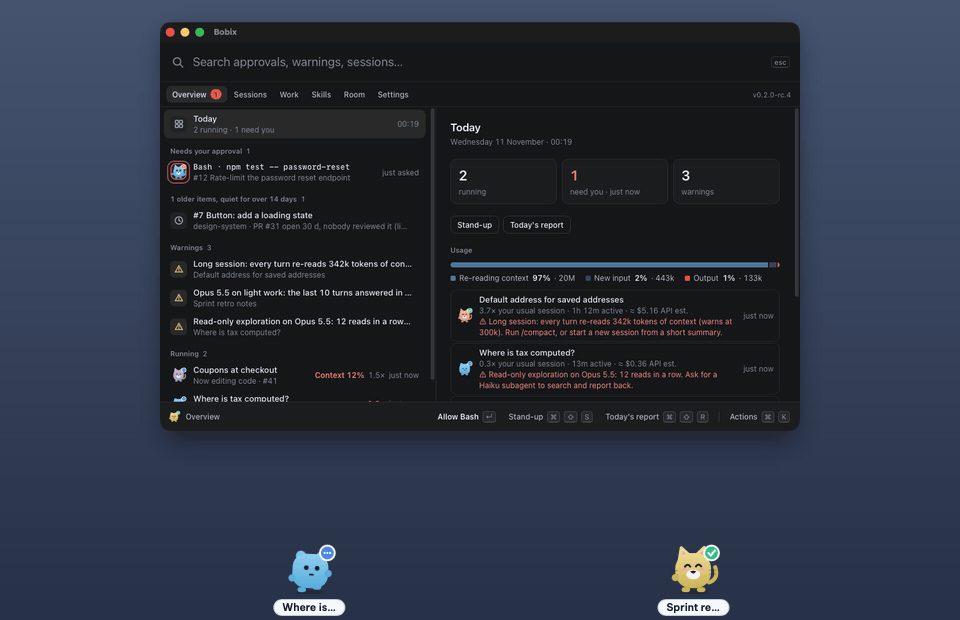
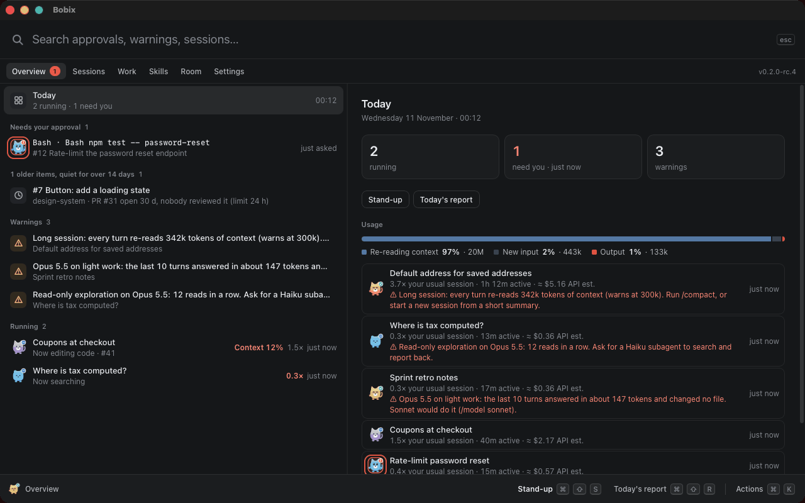
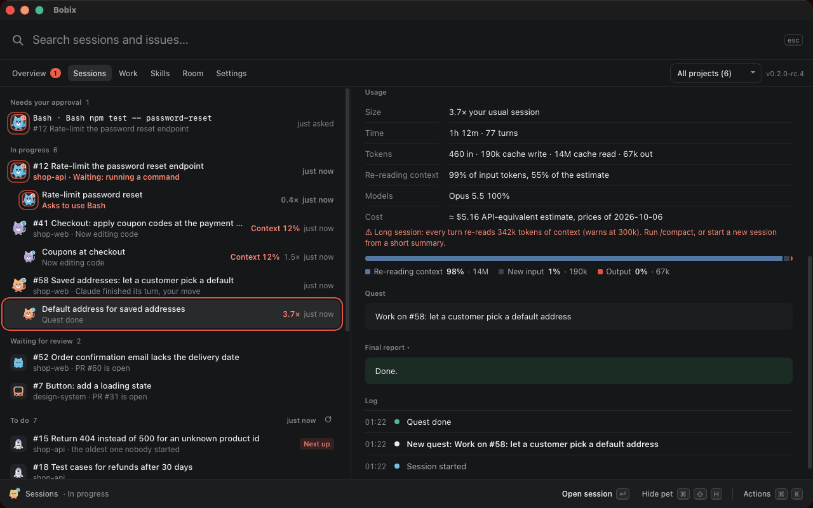
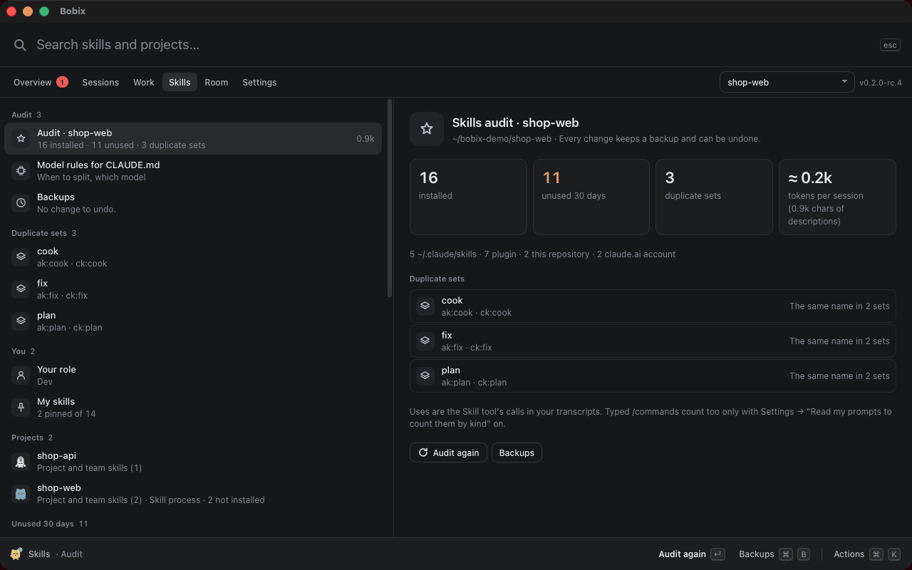

<p align="center"></p>

<h1 align="center">Bobix</h1>

<p align="center"><b>A personal assistant for working well with Claude Code.</b><br>
Every session is a pet on your screen. Answer approvals without switching windows, see what each session uses against your normal, keep your skills lean, and run your tickets.</p>

<p align="center">
  <a href="https://github.com/baonguyen-agilityio/bobix/releases"></a>
  <a href="https://github.com/baonguyen-agilityio/bobix/actions/workflows/smoke.yml"></a>
  
  <a href="LICENSE"></a>
</p>

<p align="center"><b>English</b> · <a href="README.vi.md">Tiếng Việt</a></p>

<p align="center"></p>

---

## Why

Run a few Claude Code sessions at once and the day goes to clicking through them: still working? stuck on a permission prompt? done? Is this one getting expensive? Bobix answers that at a glance, and helps you use Claude well while you work.

| The pet… | means |
|----------|-------|
| walks along the edge, blue "…" badge | Claude is working |
| taps its foot in a coral ring, "!" badge | Claude waits for your approval |
| waves and jumps, green tick | the session finished its turn |
| sleeps | nothing happening; after a while it leaves the screen |

**Click a pet to jump into its session.** Point at it to see its task, how much context is left, its usage and any warning, or its request with Allow / Deny.

## Features

### Pets for your sessions
- **One pet per session.** A project's sessions (git worktrees too) share one of five flat-icon designs, each session in a colour of its own, named after the session's title.
- **One line along the edge** of the screen you choose, top or bottom, walking one way; side sessions walk right behind the session they came from. Or **Show when needed**: only a session that needs you rises up the screen until you answer it.
- **Small signals**: a level-up when a session finishes a task, a low battery when its context runs low. With reduced motion they stay off; the badge and the coral ring still say what needs you.

### Answer approvals without switching windows
- When Claude asks for permission, answer **Allow** or **Deny** on the pet, in the panel or on the notification (macOS). The request that has waited longest comes first, and one that deletes or overwrites data is marked.
- Claude still asks in the terminal at the same time, so you can answer in either place. Bobix sets no standing rules; for that, use Claude's own auto mode.

### See what each session uses
- For every live session: tokens, the share spent **re-reading context**, the models it used (subagents too) and its active time, read from the transcripts Claude Code writes on your machine.
- Measured **against your normal**: "3.7× your usual session", learned from your own past sessions. A dollar figure is only an API-equivalent estimate, labelled as such, and can be turned off; your real limits stay in Claude's `/usage`.
- **Warnings with the reason and the fix**: a session that is too long (start a new session from a short summary, or `/clear` if the task changed), a heavy model on light work (`/model sonnet`), or a long run of read-only exploration (ask for the built-in Explore subagent, on Haiku).

### Keep your skills lean, and route models
- **Skills audit per project**: every skill Claude loads there, what its descriptions cost in every turn, those unused for 30 days and duplicate sets (`acme:build` and `team:build`).
- **Disable or remove** a personal or project skill in one click; each change keeps a backup and can be undone.
- **Model rules for `CLAUDE.md`**: a short "when to split, which model" block, shown before it is added, and undone byte for byte.

### Run your tickets
- **Your GitHub and GitLab issues**, read through your own `gh` and `glab` (on by default wherever you are signed in; one switch each turns it off): to do, in progress with their sessions, waiting for review, done today. Bobix suggests the next one, warns when two sessions work on one issue, and flags stuck work with its next step.
- **Start** an issue under **Work**, one of two ways: **Full** runs the ticket flow (its own worktree and branch, a plan you approve, checks, review, MR / PR and CI); **Quick** opens a plain Claude session in the project folder with a prompt you can edit and a skill suggested for that repository. Either session is named `[CODE-27] …`. **Change folder…** in the Start box points a project at another clone.
- **Stand-up and today's report** as plain text to copy. Bobix sends nothing.

### The panel
- One window with a search field and screens: **Overview** (what needs you, warnings, today's usage), **Sessions** (Claude sessions, grouped by issue), **Work** (issues to start, and the ticket flow), **Skills**, **Room** and **Settings**.
- Every action has a key, and ⌘K / Ctrl+K finds any action, session or screen.
- **Open a session from wherever it shows**: an Overview row, the Sessions tab, a pet's card (**Open session**, whatever the click action is), a pet click (when set to open), a notification, the menu bar or tray list of sessions waiting for you, and ⌘K (↵ opens it, ⇧↵ shows its details). A session that waits for your approval says **Approve** instead. In Work, a running session's button says **Open session**; **Resume** reopens one that has ended in the Claude desktop app, and an ended terminal session says so and offers `claude --resume <id>` to copy.

### Habits and rooms (only if you use them)
- **Habits become skills** (off by default: needs "Read my prompts to count them by kind" and the weekly scan, both in Settings → Usage). Once a week Bobix gives the prompts you typed in the last 14 days to Haiku through your own `claude -p`, finds the requests you make every week and drafts a skill you can edit. Only **Approve and install** writes it to `~/.claude/skills`, and every version can be undone. This sends text to Anthropic, through your own Claude.
- **Room**: a war room for one problem, over your Tailscale network. The host's computer hosts it on its Tailscale address only; people the host invites chat; the host's own Claude arranges the chat into problem, options, pros and cons, and the host decides. It needs Tailscale, on a tailnet where the laptops can reach each other, and has not been tried between two real machines yet.

### And
- **Notifications** when a session needs approval or finishes, the number of sessions waiting for you on the menu bar or tray icon, **Do not disturb** for 30 or 60 minutes, an optional local log of your habits with Claude (opt-in, 30 days, never what you write), and a notification when a new version is out, which you can install from the app (it asks first).
- **Stays out of your way**: pick the screen, edge, area, size and visibility; pets fade near the cursor and let clicks through.
- **macOS, Windows and Linux**, in English and Vietnamese. macOS is what a release is tested on by hand; Windows and Linux are tried by a person on a real machine and by CI (see Status and limitations).
- **Private by design**: runs on your computer, no account, nothing goes to Bobix's author. By default it only reads your issues through your own `glab` / `gh`, and reads GitHub's update list once a day to see whether a new version is out (you can turn either off); it downloads a new version only when you press Update. Text goes to Anthropic only for the features you switch on or press, through your own Claude. See [Privacy](docs/privacy.md).

## Install

Download the installer for your computer. The links give the newest stable release, which is still 0.1.3 while 0.2 is in test builds (GitHub does not count pre-releases as latest); for a 0.2 test build pick one from [all releases](https://github.com/baonguyen-agilityio/bobix/releases):

| Your computer | Download |
|---|---|
| Mac with Apple chip (M1 and later) | [Bobix-mac-arm64.dmg](https://github.com/baonguyen-agilityio/bobix/releases/latest/download/Bobix-mac-arm64.dmg) |
| Mac with Intel chip | [Bobix-mac-x64.dmg](https://github.com/baonguyen-agilityio/bobix/releases/latest/download/Bobix-mac-x64.dmg) |
| Windows 10 / 11 (64-bit) | [Bobix-windows-x64.exe](https://github.com/baonguyen-agilityio/bobix/releases/latest/download/Bobix-windows-x64.exe) |
| Ubuntu / Debian (amd64) | [bobix-linux-amd64.deb](https://github.com/baonguyen-agilityio/bobix/releases/latest/download/bobix-linux-amd64.deb) |
| Ubuntu / Debian (ARM64) | [bobix-linux-arm64.deb](https://github.com/baonguyen-agilityio/bobix/releases/latest/download/bobix-linux-arm64.deb) |

Then:

1. Open the app. The builds are not code-signed yet, so the first launch shows a warning; the [install guide](docs/install.md) shows how to get past it on each system.
2. The panel opens on **Settings → Connect Claude Code**. Click **Install hooks**.
3. Send a prompt in any Claude Code session. Its pet appears.

The [install guide](docs/install.md) also covers troubleshooting and uninstalling.

### From a terminal, or with an AI assistant

Use the release installers below. Don't clone this repository or build it to install Bobix: the source is for contributors.

macOS (Apple chip; on an Intel Mac use `Bobix-mac-x64.dmg`). Quit Bobix first if it is running.

```bash
curl -fL -o /tmp/Bobix.dmg https://github.com/baonguyen-agilityio/bobix/releases/latest/download/Bobix-mac-arm64.dmg
hdiutil attach -nobrowse -quiet -mountpoint /tmp/bobix-dmg /tmp/Bobix.dmg
rm -rf /Applications/Bobix.app && cp -R /tmp/bobix-dmg/Bobix.app /Applications/
hdiutil detach -quiet /tmp/bobix-dmg && xattr -cr /Applications/Bobix.app && open /Applications/Bobix.app
```

Windows (PowerShell):

```powershell
$f = "$env:TEMP\Bobix-windows-x64.exe"; Invoke-WebRequest https://github.com/baonguyen-agilityio/bobix/releases/latest/download/Bobix-windows-x64.exe -OutFile $f; Start-Process $f
```

Ubuntu / Debian (amd64; on ARM use `bobix-linux-arm64.deb`), then open **Bobix** from your apps menu:

```bash
curl -fL -o /tmp/bobix.deb https://github.com/baonguyen-agilityio/bobix/releases/latest/download/bobix-linux-amd64.deb && sudo apt install -y /tmp/bobix.deb
```

## Screenshots

<table>
<tr>
<td colspan="2"></td>
</tr>
<tr>
<td colspan="2"><b>Overview</b>: what needs you first, then warnings and today's usage.</td>
</tr>
<tr>
<td width="50%"></td>
<td width="50%"></td>
</tr>
<tr>
<td><b>A session's usage</b> against your normal, with the reason for a warning.</td>
<td><b>Skills audit</b>: unused skills and duplicate sets, each change undoable.</td>
</tr>
</table>

## How it works

```
Claude Code ──hooks──▶ node ~/.claude/bobix/hook.js ──127.0.0.1──▶ Bobix ──▶ pets · panel · notifications
                                                                              ├─ reads the session transcript: title, last answer, context left, usage
                                                                              └─ reads your skill folders and transcripts for the skills audit
```

- Uses Claude Code's documented hooks: SessionStart, UserPromptSubmit, PreToolUse, PostToolUse, PermissionRequest, Notification, Stop, SessionEnd. They run asynchronously, so Claude never waits for them.
- Installing adds entries to `~/.claude/settings.json`, keeps every other hook and setting, and saves a backup first. Removing takes out only Bobix's entries.
- The forwarder sends what the pets show (tool name, file path or command, your prompt), never file contents or tool output.
- An Esc or a denied permission ends a turn without a hook; Bobix notices it in the transcript and puts the pet to rest.
- Bobix changes Claude's skill folders or a project's `CLAUDE.md` only when you click, always with a backup and an undo. It never reads your Claude login.
- It finds `glab`, `gh` and `claude` by asking your login shell (`command -v <name>`, 5 seconds at most), because an app started from the Dock does not see your shell's `PATH`. **Copy terminal command** puts a command on your clipboard for you to paste; Bobix never runs it.

## FAQ

**Does it slow Claude down?** No. Hooks run asynchronously and the forwarder exits within a few tens of milliseconds.

**What about chats in the Claude app or on claude.ai?** Not supported. Bobix follows Claude Code sessions through Claude Code's hooks, and ordinary chats have no hooks or any other way for an app on your computer to follow them. In the Claude desktop app, use the Code tab: those are Claude Code sessions and show up as pets.

**Which Claude Code setups work?** The CLI in any terminal, the IDE extensions and the Claude desktop app. Click-to-open goes straight to the session in the desktop app; elsewhere it brings the app forward, not a specific tab.

**What if I don't have Node.js?** Hooks fall back to `curl` or PowerShell. Everything works except click-to-open, which then shows the session's details.

**It shows nothing on my work laptop.** Your organization may allow only managed hooks (`allowManagedHooksOnly`). Bobix respects that and cannot receive events there.

**Is my code sent anywhere?** Not by Bobix, and nothing goes to its author. By default Bobix makes two kinds of request: the daily check for a new version, and reading your issues through your own `glab` / `gh`. Text goes to Anthropic only for features you switch on or press, through your own `claude -p`: the weekly habits scan (the prompts you typed), the habits draft (examples of those prompts and the skill file it improves; Claude may also read files with its Read tool), the ticket helper (an issue's title and description, or a work log, commit subjects and changed file names) and the room draft (the room's chat). Bobix does not send your project's source files; the one file it puts in a prompt is the skill you ask it to improve. A Full Start also runs `git fetch` on your project's remote, and Push and open MR / PR pushes your branch, both only when you click. See [Privacy](docs/privacy.md).

## Status and limitations

- Version 0.2 is in test builds (see [releases](https://github.com/baonguyen-agilityio/bobix/releases)); the last stable release is 0.1.3. The app is built with Tauri (Rust and the system web view): the installers are about 4 MB (0.1.3 was 92 to 120 MB) and the installed app about 9 MB on macOS.
- macOS decides a release: it is tried by hand with the Claude desktop app and the CLI. Windows and Linux run the CI smoke test and are then tried by a person on a real machine; what still fails there is listed under known limits in the [roadmap](docs/roadmap.md). Not tried yet: Windows with real Claude Code sessions, the Claude desktop app on Linux (beta), and Room between two machines.
- On Linux Wayland, Bobix runs through XWayland so pets can stay on top; bringing a terminal forward needs X11 and `xdotool`.
- Opening a session in the Claude desktop app uses a link that app registers (`claude://code/continue`), not a documented API, so it may change.
- "Context left" is estimated from token usage.
- Linux installers are for Ubuntu 22.04+ and Debian 12+ (they need WebKitGTK 4.1, which `apt` installs with them); other distributions aren't packaged yet.
- Windows needs the WebView2 runtime: built into Windows 11 and current Windows 10; the installer adds it when it is missing.
- Installing 0.2 over 0.1 keeps your settings, hooks and saved pet pictures (picture pets are hidden for now), removes the old app, and keeps "start when I log in" on if it was.

## License and credits

MIT, see [LICENSE](LICENSE). Fonts: Baloo 2 and Be Vietnam Pro, SIL Open Font License, bundled via Fontsource (licenses in `src/ui/fonts/`). GIF code: [gifenc](https://github.com/mattdesl/gifenc) by Matt DesLauriers and the LZW decoder and deinterlacer of [gifuct-js](https://github.com/matt-way/gifuct-js) by Matt Way, MIT, copied into `src/ui/gif/` with their licenses.

Bobix is an independent project, not affiliated with or endorsed by Anthropic. "Claude" and "Claude Code" are trademarks of Anthropic.

## Developing Bobix

For contributors only: building, testing and releasing are in [docs/development.md](docs/development.md); open work is in [docs/roadmap.md](docs/roadmap.md). To use Bobix, install it from the release as shown above.
