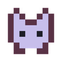
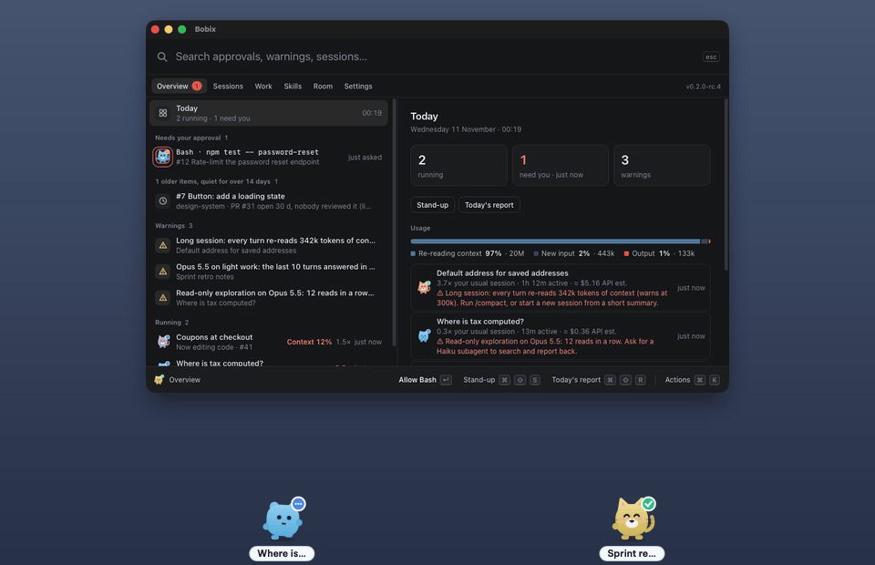
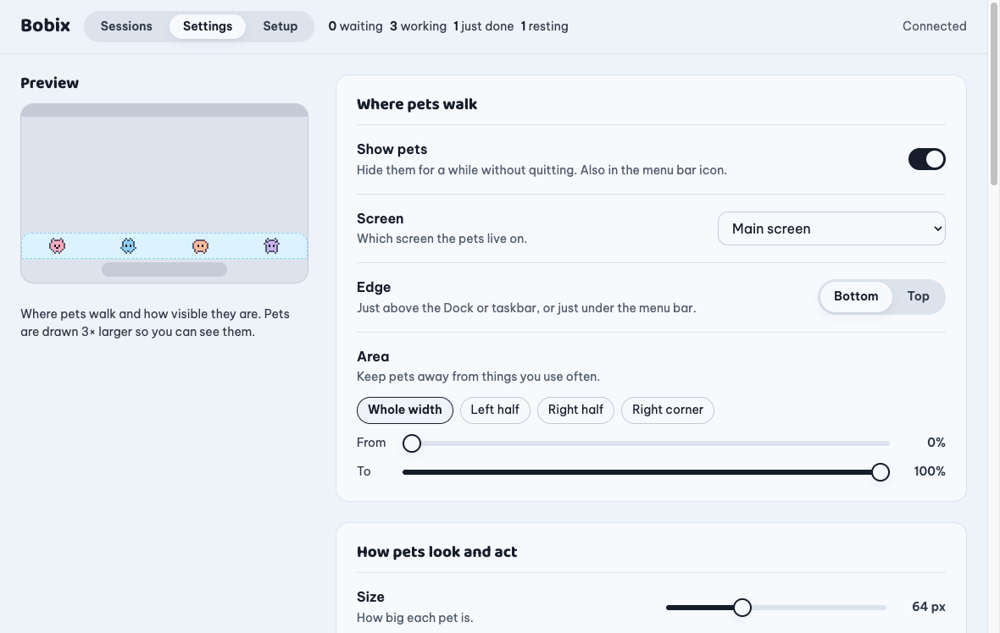
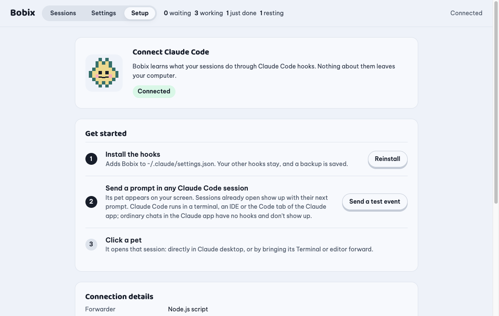

<p align="center"></p>

<h1 align="center">Bobix</h1>

<p align="center"><b>Mỗi session Claude Code là một chú thú pixel trên màn hình của bạn.</b><br>
Liếc xuống là biết session nào đang làm, session nào cần bạn, session nào đã xong, không phải mở cửa sổ nào.</p>

<p align="center">
  <a href="https://github.com/baonguyen-agilityio/bobix/releases"></a>
  <a href="https://github.com/baonguyen-agilityio/bobix/actions/workflows/smoke.yml"></a>
  
  <a href="LICENSE"></a>
</p>

<p align="center"><a href="README.md">English</a> · <b>Tiếng Việt</b></p>

<p align="center"></p>

<p align="center"><a href="docs/media/demo.mp4">Xem video demo chất lượng đầy đủ (16 giây)</a></p>

---

## Vì sao có Bobix

Chạy vài session Claude Code cùng lúc thì bạn sẽ phải bấm qua từng cái để xem: còn đang làm không? có kẹt ở bước xin quyền không? xong chưa? Bobix cho mỗi session một chú thú đi dọc mép màn hình để trả lời ngay những câu đó.

| Chú thú… | nghĩa là |
|----------|----------|
| đi lại, bong bóng kiểu *đang chạy lệnh* | Claude đang làm |
| nhảy, bong bóng đỏ *Cần bạn duyệt: Bash* | Claude đang chờ bạn duyệt |
| cười, bong bóng xanh *Xong nhiệm vụ!* | session đã xong lượt |
| ngủ | không có gì xảy ra; ngủ lâu thì tạm rời màn hình |

**Bấm vào chú thú để mở đúng session đó.** Rê chuột lên để xem việc đang làm, trạng thái và lượng context còn lại.

## Tính năng

- **Mỗi session một chú thú, dáng theo project**: mọi session của cùng một project (kể cả git worktree) có chung dáng nhưng mỗi session một màu, tên lấy theo tiêu đề session. Có thể đặt ảnh riêng làm mặt thú cưng cho từng project trong bảng điều khiển (Đổi thú cưng); Bobix biến ảnh thành pixel art và cho bạn chỉnh lại, dùng làm mặt thú cưng hoặc thay cả thú cưng. Session phụ đi ngay sau session đã tách ra nó.
- **Một hàng thú cưng**: mọi chú thú đi cùng một chiều (trái sang phải, hoặc phải sang trái trong Cài đặt), cách đều nhau, ra ở một đầu đoạn mép rồi vào lại ở đầu kia; cả gia đình đi liền nhau, con gốc đi trước. Đông hơn chỗ thì lần lượt thay phiên. Chỉ chuột vào một chú thú thì cả hàng dừng lại, hiện thẻ của chính nó, hoặc yêu cầu của nó với nút Cho phép / Từ chối. Kéo một chú thú sang chỗ khác, thả ra thì nó trượt vào hàng ở chỗ đó. Hiệu ứng pixel gọn trong chỗ của từng con; khi bật giảm chuyển động thì không có hiệu ứng, mỗi con cầm một quả bóng bay báo việc cần bạn.
- **Hoặc chỉ hiện khi có việc** (Cài đặt → Kiểu hiện pet → Hiện khi có việc): mép màn hình để trống. Phiên nào cần bạn (chờ duyệt, vừa xong việc, sắp hết ngữ cảnh) thì chú thú của nó treo dưới một quả bóng bay, bay từ dưới mép màn hình lên quá mép trên, lặp lại tới khi bạn trả lời hoặc đã xem; nó không dừng giữa chừng, trừ khi bạn chỉ chuột vào, khi đó hiện thẻ của nó với nút Cho phép / Từ chối. Một nút ở góc màn hình đếm số phiên và liệt kê chúng, có Cho phép / Từ chối. Khi bật giảm chuyển động, chú thú đứng yên gần mép dưới.
- **Đừng làm phiền** 30 hoặc 60 phút (Cài đặt): không có thú cưng và không có thông báo trong lúc đó; yêu cầu duyệt vẫn chờ ở Bảng, và nút ở góc cho phép tắt sớm.
- **Bấm để mở** session: vào thẳng session trong app Claude desktop, hoặc đưa cửa sổ Terminal, iTerm, VS Code lên trước.
- **Phiên phụ** (app Claude desktop): session tách ra từ một session khác đi ngay sau session gốc, và bảng điều khiển cho biết nó tách từ đâu, còn bao nhiêu session phụ đang chạy hay cần bạn.
- **Duyệt ngay trên Bobix**: khi Claude xin quyền, bấm Cho phép hoặc Từ chối trên chú thú, trong bảng điều khiển hoặc trên thông báo (macOS); yêu cầu xoá hoặc ghi đè dữ liệu có cảnh báo trong bảng điều khiển. Bobix không đặt luật cho phép lâu dài: muốn vậy thì dùng auto mode của Claude. Mặc định Bobix giữ yêu cầu cho tới khi bạn trả lời ở đó; Claude vẫn hỏi song song trong terminal, nên trả lời ở đâu cũng được. Đặt giới hạn thời gian trong Cài đặt thì Bobix sẽ thôi giữ yêu cầu khi hết giờ. Khi các chú thú đang ẩn hoặc thông báo đang tạm dừng thì Bobix không giữ yêu cầu.
- **Công việc** (tự bật): trạng thái git của từng session (nhánh, file đã đổi, commit chưa push), và bảng theo ngày làm việc: issue GitLab và GitHub được giao cho bạn cần làm, đang làm (kèm các phiên), chờ kiểm tra (có pull request hoặc merge request đang mở của bạn đóng nó) và xong hôm nay, GitLab hay GitHub nào cũng được, đọc qua `glab` và `gh` của chính bạn. Mở một ticket thấy bước của nó (Cần làm › Đang làm › Chờ duyệt › Chờ kiểm tra › Xong) và vì sao; hai phiên cùng một issue hay cùng một nhánh có cảnh báo. Báo cáo cuối ngày theo dự án và standup (xong ngày làm việc trước, đang làm hôm nay, đang kẹt), dạng chữ để sao chép; Bobix không gửi gì đi. Session đang ở nhánh của một issue (`29-…`) hiện `#29`, và issue đó hiện session đang làm. Mỗi issue có một nút: mở lại session đang làm nó (kể cả session đã mở từ Bobix trước đó, tìm theo tên), hoặc mở session Claude desktop mới trong thư mục project với prompt sửa được (tiêu đề, mô tả và link issue) điền sẵn và chép vào clipboard; cột Cần làm gợi ý việc tiếp theo. Session đầu tiên bạn tạo ở đó được đặt tên theo issue (`[SHA-27] …`, mỗi project một mã ngắn, sửa được trong Cài đặt). Mặc định tắt, GitLab và GitHub mỗi bên một công tắc; Bobix không giữ token và không ghi gì lên cả hai.
- **Thói quen** (tự bật, Cài đặt → Bobix nhớ gì về bạn): Bobix ghi lại trên máy việc bạn làm với Claude (giờ, repo, issue, nhánh, số lần và thời gian chờ duyệt, skill; không bao giờ nhớ nội dung bạn viết) trong 30 ngày, cho bạn xem theo từng ngày và Xoá hết, rồi sau vài ngày gợi ý tối đa 3 bước tiếp theo ngay dưới phần cần duyệt: issue còn dở, lệnh lần nào bạn cũng cho phép (một dòng để bạn tự thêm vào cài đặt quyền của Claude), việc bạn mở cùng giờ mỗi tuần, skill bạn hay dùng ở một repo. Quy tắc đơn giản trên máy, không dùng AI, không gửi gì đi.
- **Bảng điều khiển** liệt kê mọi session theo mức cần bạn chú ý, kèm câu trả lời cuối và nhật ký các tool đã dùng.
- **Thông báo** khi session cần duyệt hoặc đã xong, có âm thanh nếu muốn.
- **Không che việc của bạn**: chọn màn hình, mép trên hoặc dưới, đoạn mép được đi, kích thước và độ rõ. Chú thú mờ đi khi chuột lại gần, mọi chỗ không phải chú thú đều cho click xuyên qua, con ngủ quá lâu sẽ rời màn hình sau khoảng thời gian bạn chọn.
- **Nhẹ máy**: không vẽ gì khi không có con nào, không ghi ổ đĩa ngoài file cài đặt.
- **macOS, Windows và Linux**, tiếng Anh và tiếng Việt.
- **Riêng tư**: chạy hoàn toàn trên máy bạn, không cần tài khoản, không gửi gì về bạn hay các session ra ngoài. Yêu cầu mạng duy nhất Bobix tự làm là mỗi ngày hỏi GitHub có bản mới chưa, và bạn tắt được; issue GitLab chỉ được đọc khi bạn bật. Xem [Quyền riêng tư](docs/privacy.md).
- **Báo khi có bản mới**: có phiên bản mới thì hiện thông báo và mục trong khay để tải về.

## Cài đặt

Tải file cài cho máy của bạn. Các link luôn trỏ tới phiên bản mới nhất ([tất cả bản phát hành](https://github.com/baonguyen-agilityio/bobix/releases)):

| Máy của bạn | Tải về |
|---|---|
| Mac chip Apple (M1 trở lên) | [Bobix-mac-arm64.dmg](https://github.com/baonguyen-agilityio/bobix/releases/latest/download/Bobix-mac-arm64.dmg) |
| Mac chip Intel | [Bobix-mac-x64.dmg](https://github.com/baonguyen-agilityio/bobix/releases/latest/download/Bobix-mac-x64.dmg) |
| Windows 10 / 11 (64-bit) | [Bobix-windows-x64.exe](https://github.com/baonguyen-agilityio/bobix/releases/latest/download/Bobix-windows-x64.exe) |
| Ubuntu / Debian (amd64) | [bobix-linux-amd64.deb](https://github.com/baonguyen-agilityio/bobix/releases/latest/download/bobix-linux-amd64.deb) |
| Ubuntu / Debian (ARM64) | [bobix-linux-arm64.deb](https://github.com/baonguyen-agilityio/bobix/releases/latest/download/bobix-linux-arm64.deb) |

Sau đó:

1. Mở app. Bản build chưa được ký số nên lần đầu mở sẽ có cảnh báo; [hướng dẫn cài đặt](docs/install.md) chỉ cách mở trên từng hệ điều hành.
2. Trong bảng điều khiển, vào **Kết nối → Cài hooks**.
3. Gửi một prompt trong session Claude Code bất kỳ. Chú thú của nó sẽ xuất hiện.

[Hướng dẫn cài đặt](docs/install.md) (tiếng Anh) có thêm phần xử lý sự cố và gỡ cài đặt.

### Cài bằng terminal, hoặc nhờ trợ lý AI

Hãy dùng file cài trong bản phát hành như dưới đây. Đừng clone repo này hay tự build để cài Bobix: mã nguồn dành cho người đóng góp.

macOS (chip Apple; Mac chip Intel dùng `Bobix-mac-x64.dmg`). Nếu Bobix đang chạy thì thoát trước.

```bash
curl -fL -o /tmp/Bobix.dmg https://github.com/baonguyen-agilityio/bobix/releases/latest/download/Bobix-mac-arm64.dmg
hdiutil attach -nobrowse -quiet -mountpoint /tmp/bobix-dmg /tmp/Bobix.dmg
rm -rf /Applications/Bobix.app && cp -R /tmp/bobix-dmg/Bobix.app /Applications/
hdiutil detach -quiet /tmp/bobix-dmg && xattr -cr /Applications/Bobix.app && open /Applications/Bobix.app
```

Windows (PowerShell):

```powershell
$f = "$env:TEMP\Bobix-windows-x64.exe"; Invoke-WebRequest https://github.com/baonguyen-agilityio/bobix/releases/latest/download/Bobix-windows-x64.exe -OutFile $f; Start-Process $f
```

Ubuntu / Debian (amd64; máy ARM dùng `bobix-linux-arm64.deb`), rồi mở **Bobix** từ menu ứng dụng:

```bash
curl -fL -o /tmp/bobix.deb https://github.com/baonguyen-agilityio/bobix/releases/latest/download/bobix-linux-amd64.deb && sudo apt install -y /tmp/bobix.deb
```

## Ảnh chụp

<table>
<tr>
<td width="50%"></td>
<td width="50%"></td>
</tr>
<tr>
<td><b>Cài đặt</b> có xem trước chỗ chú thú đi.</td>
<td><b>Kết nối</b> Claude Code chỉ với một cú bấm.</td>
</tr>
</table>

## Cách hoạt động

```
Claude Code ──hooks──▶ node ~/.claude/bobix/hook.js ──127.0.0.1──▶ Bobix ──▶ chú thú · bảng điều khiển · thông báo
                                                                              └─ đọc transcript của session để lấy tiêu đề, câu trả lời cuối và context còn lại
```

- Dùng các hook có trong tài liệu của Claude Code: SessionStart, UserPromptSubmit, PreToolUse, PostToolUse, PermissionRequest, Notification, Stop, SessionEnd. Hook chạy bất đồng bộ nên Claude không bao giờ phải chờ.
- Khi cài, Bobix thêm mục vào `~/.claude/settings.json`, giữ nguyên mọi hook và cài đặt khác, và lưu bản backup trước. Khi gỡ, chỉ các mục của Bobix bị xoá.
- Bộ chuyển tiếp chỉ gửi những gì chú thú hiển thị (tên tool, đường dẫn file hoặc lệnh, prompt của bạn), không bao giờ gửi nội dung file hay kết quả tool.
- Bấm Esc hoặc từ chối quyền sẽ kết thúc lượt mà không có hook nào; Bobix nhận ra điều đó trong transcript và cho chú thú nghỉ.

## Câu hỏi thường gặp

**Có làm Claude chậm đi không?** Không. Hook chạy bất đồng bộ và bộ chuyển tiếp thoát sau vài chục mili giây.

**Còn các cuộc chat trong app Claude hay trên claude.ai thì sao?** Chưa hỗ trợ được. Bobix theo dõi session của Claude Code qua hooks của Claude Code, còn chat thường không có hooks hay cách nào khác để một app trên máy bạn theo dõi. Trong app Claude desktop, hãy dùng tab Code: đó là session Claude Code nên sẽ hiện thành thú cưng.

**Dùng được với những cách chạy Claude Code nào?** CLI trong mọi terminal, extension cho IDE và app Claude desktop. Bấm để mở sẽ vào thẳng session trong app desktop; ở chỗ khác thì đưa cửa sổ app lên trước, không chọn được đúng tab.

**Không có Node.js thì sao?** Hook chuyển sang dùng `curl` hoặc PowerShell. Mọi thứ vẫn chạy, trừ bấm để mở: khi đó app hiện chi tiết session.

**Máy công ty không hiện gì cả.** Tổ chức của bạn có thể chỉ cho phép hook do quản trị cài (`allowManagedHooksOnly`). Bobix tôn trọng thiết lập đó nên không nhận được sự kiện.

**Code của tôi có bị gửi đi đâu không?** Không. Xem [Quyền riêng tư](docs/privacy.md).

## Tình trạng và giới hạn

- Phiên bản 0.2 (bản thử). App được làm bằng Tauri (Rust và trình duyệt có sẵn của hệ điều hành; khoảng 10 MB thay vì 250 MB). Bản 0.1 đã thử trên macOS (chip Apple) với app Claude desktop và CLI, và trên Ubuntu (Wayland) với CLI. Windows mới chạy smoke test trên CI; app Claude desktop cho Linux (bản beta) chưa được thử.
- Trên Linux Wayland, Bobix chạy qua XWayland để chú thú luôn nằm trên cùng; đưa terminal lên trước cần X11 và `xdotool`.
- Mở session trong app Claude desktop dùng một đường link do app đó đăng ký (`claude://code/continue`), không phải API có tài liệu, nên có thể thay đổi.
- "Ngữ cảnh còn lại" là ước tính từ lượng token đã dùng.
- File cài cho Linux dành cho Ubuntu 22.04+ và Debian 12+ (cần WebKitGTK 4.1, `apt` tự cài kèm); các bản Linux khác chưa có gói cài.
- Windows cần WebView2: có sẵn trên Windows 11 và Windows 10 bản mới; trình cài tự thêm nếu thiếu.
- Cài 0.2 đè lên 0.1 vẫn giữ cài đặt, hook và ảnh thú cưng, gỡ app cũ, và giữ "mở khi đăng nhập" nếu đang bật.

## Giấy phép và ghi công

MIT, xem [LICENSE](LICENSE). Font: Baloo 2 và Be Vietnam Pro, giấy phép SIL Open Font License, đóng gói qua Fontsource (giấy phép nằm trong `src/ui/fonts/`). Mã GIF: [gifenc](https://github.com/mattdesl/gifenc) của Matt DesLauriers, bộ giải mã LZW và bộ khử interlace của [gifuct-js](https://github.com/matt-way/gifuct-js) của Matt Way, giấy phép MIT, chép vào `src/ui/gif/` kèm giấy phép.

Bobix là dự án độc lập, không liên kết với Anthropic và không được Anthropic bảo trợ. "Claude" và "Claude Code" là nhãn hiệu của Anthropic.

## Phát triển Bobix

Chỉ dành cho người đóng góp: build, test và phát hành nằm trong [docs/development.md](docs/development.md); việc còn dang dở nằm trong [docs/roadmap.md](docs/roadmap.md) (tiếng Anh). Để dùng Bobix, hãy cài từ bản phát hành như hướng dẫn ở trên.
