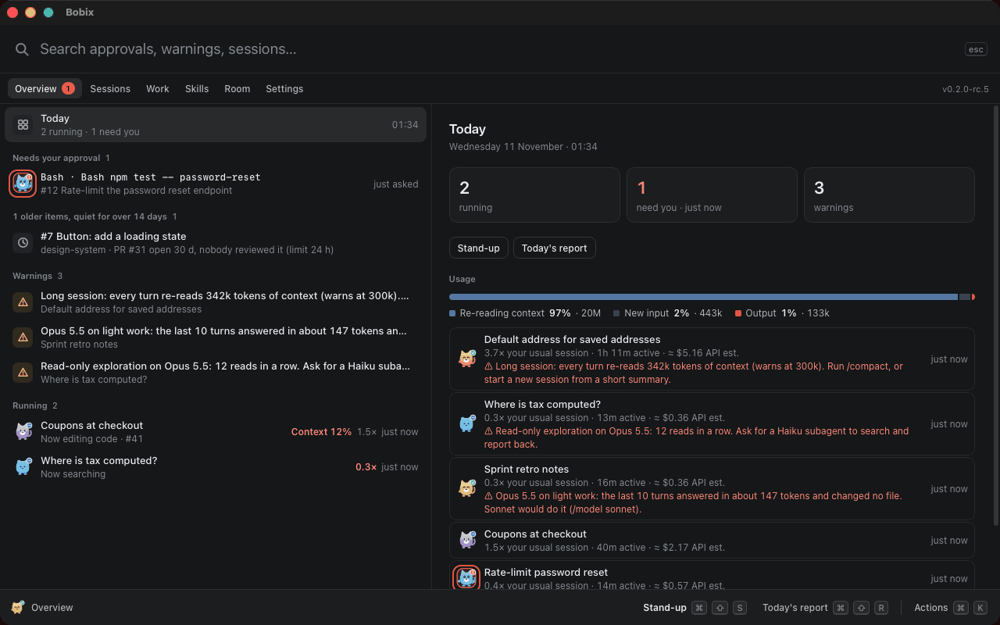
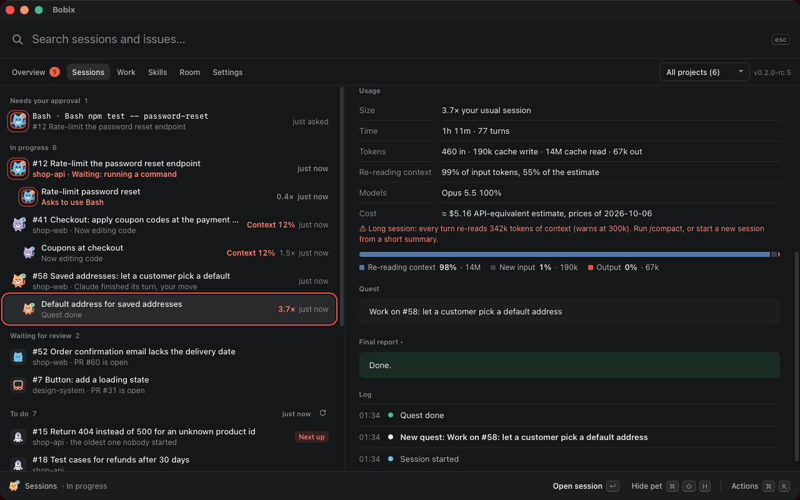
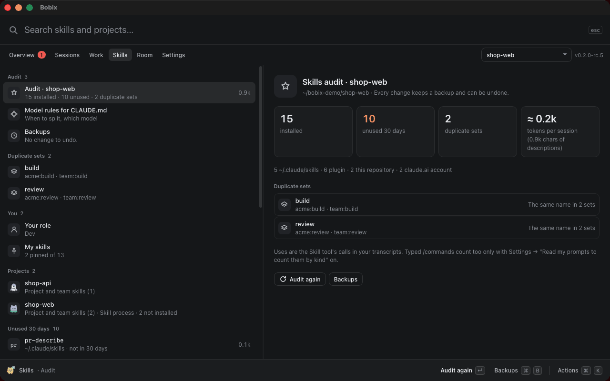

<p align="center"></p>

<h1 align="center">Bobix</h1>

<p align="center"><b>Trợ lý cá nhân giúp bạn làm việc tốt với Claude Code.</b><br>
Mỗi session là một chú thú trên màn hình. Duyệt yêu cầu mà không phải chuyển cửa sổ, xem mỗi session dùng bao nhiêu so với mức thường ngày của bạn, giữ bộ skill gọn gàng, và chạy ticket của bạn.</p>

<p align="center">
  <a href="https://github.com/baonguyen-agilityio/bobix/releases"></a>
  <a href="https://github.com/baonguyen-agilityio/bobix/actions/workflows/smoke.yml"></a>
  
  <a href="LICENSE"></a>
</p>

<p align="center"><a href="README.md">English</a> · <b>Tiếng Việt</b></p>

<p align="center"></p>

---

## Vì sao có Bobix

Chạy vài session Claude Code cùng lúc thì cả ngày sẽ đi vào việc bấm qua từng cái: còn đang làm không? có kẹt ở bước xin quyền không? xong chưa? Session này có đang tốn quá không? Bobix trả lời ngay những câu đó, và giúp bạn dùng Claude hiệu quả trong lúc làm việc.

| Chú thú… | nghĩa là |
|----------|----------|
| đi dọc mép màn hình, huy hiệu "…" xanh | Claude đang làm |
| gõ chân trong vòng viền cam, huy hiệu "!" | Claude đang chờ bạn duyệt |
| vẫy tay rồi nhảy, dấu tích xanh | session đã xong lượt |
| ngủ | không có gì xảy ra; ngủ lâu thì rời màn hình |

**Bấm vào chú thú để vào đúng session đó.** Chỉ chuột vào để xem việc đang làm, context còn lại, mức dùng và cảnh báo nếu có, hoặc yêu cầu của nó với Cho phép / Từ chối.

## Tính năng

### Thú cưng cho các session
- **Mỗi session một chú thú.** Các session của cùng một project (kể cả git worktree) dùng chung một trong năm mẫu thú kiểu icon phẳng, mỗi session một màu riêng, tên lấy theo tiêu đề session.
- **Một hàng dọc mép** màn hình bạn chọn, mép trên hoặc mép dưới, đi cùng một chiều; session phụ đi ngay sau session đã tạo ra nó. Hoặc **Hiện khi có việc**: chỉ session cần bạn mới bay lên màn hình cho tới khi bạn trả lời.
- **Tín hiệu nhỏ**: lên cấp khi session xong một việc, pin yếu khi context sắp hết. Khi bật giảm chuyển động thì không có hiệu ứng; huy hiệu và vòng cam vẫn cho biết việc gì cần bạn.

### Duyệt yêu cầu mà không chuyển cửa sổ
- Khi Claude xin quyền, bấm **Cho phép** hoặc **Từ chối** ngay trên chú thú, trong bảng điều khiển hoặc trên thông báo (macOS). Yêu cầu chờ lâu nhất lên đầu, yêu cầu xoá hoặc ghi đè dữ liệu được đánh dấu.
- Claude vẫn hỏi trong terminal cùng lúc nên bạn trả lời ở đâu cũng được. Bobix không đặt quy tắc cho phép lâu dài; muốn vậy hãy dùng chế độ auto của chính Claude.

### Xem mỗi session dùng bao nhiêu
- Với mỗi session đang chạy: token, phần dành để **đọc lại ngữ cảnh**, các model đã dùng (cả subagent) và thời gian làm việc, đọc từ transcript mà Claude Code ghi trên máy bạn.
- So **với mức thường ngày của bạn**: "3,7× phiên thường ngày", học từ chính các session trước của bạn. Số đô chỉ là ước tính theo giá API, có ghi rõ, và tắt được; hạn mức thật vẫn xem bằng `/usage` trong Claude.
- **Cảnh báo kèm lý do và cách xử lý**: session quá dài (chạy `/compact` hoặc mở session mới), model nặng cho việc nhẹ (`/model sonnet`), hay đọc khám phá liên tục (nhờ một subagent Haiku).

### Giữ bộ skill gọn gàng, chọn đúng model
- **Rà soát skill theo project**: mọi skill Claude nạp ở đó, phần mô tả của chúng tốn bao nhiêu token mỗi lượt, skill không dùng trong 30 ngày và các bộ trùng nhau (`ak:cook` và `ck:cook`).
- **Tắt hoặc xoá** một skill cá nhân hay của project bằng một cú bấm; mỗi thay đổi đều có bản sao lưu và hoàn tác được.
- **Quy tắc chọn model cho `CLAUDE.md`**: một khối ngắn "khi nào tách phiên, dùng model nào", hiện cho bạn xem trước khi thêm, và gỡ trả lại đúng từng byte.

### Chạy ticket của bạn
- **Issue GitHub và GitLab của bạn** (tự bật, qua chính `gh` và `glab` của bạn): cần làm, đang làm cùng các session của nó, chờ review, xong hôm nay. Bobix gợi ý việc làm tiếp, cảnh báo khi hai session cùng làm một issue, và chỉ ra việc bị kẹt kèm bước tiếp theo.
- **Bắt đầu** một session trên issue với prompt bạn sửa được, kèm skill gợi ý cho repo đó; session được đặt tên `[CODE-27] …`.
- **Stand-up và báo cáo hôm nay** dạng văn bản để chép. Bobix không gửi gì đi.

### Bảng điều khiển
- Một cửa sổ có ô tìm kiếm và các màn hình: **Tổng quan** (việc cần bạn, cảnh báo, mức dùng hôm nay), **Phiên** (session và issue), **Skill** và **Cài đặt**. **Công việc** và **Phòng** sắp có.
- Mọi thao tác đều có phím tắt, và ⌘K / Ctrl+K tìm bất kỳ thao tác, session hay màn hình nào.

### Và
- **Thông báo** khi session cần duyệt hoặc xong việc, số session đang chờ bạn duyệt trên biểu tượng ở thanh menu hoặc khay hệ thống, **Đừng làm phiền** 30 hoặc 60 phút, nhật ký thói quen làm việc với Claude lưu trên máy (tự bật, 30 ngày, không bao giờ lưu nội dung bạn viết), và thông báo khi có bản mới.
- **Không vướng víu**: chọn màn hình, mép, vùng, kích thước và độ rõ; chú thú mờ đi khi chuột tới gần và để cú bấm đi xuyên qua.
- **macOS, Windows và Linux**, tiếng Anh và tiếng Việt.
- **Riêng tư từ thiết kế**: chạy trên máy bạn, không tài khoản, không gửi gì về bạn hay các session đi đâu. Yêu cầu mạng duy nhất Bobix tự làm là mỗi ngày hỏi GitHub có bản mới không, và bạn tắt được. Xem [Quyền riêng tư](docs/privacy.md).

## Cài đặt

Tải file cài cho máy của bạn. Các link luôn trỏ tới phiên bản mới nhất ([tất cả bản phát hành](https://github.com/baonguyen-agilityio/bobix/releases)):

| Máy của bạn | Tải về |
|---|---|
| Mac chip Apple (M1 trở lên) | [Bobix-mac-arm64.dmg](https://github.com/baonguyen-agilityio/bobix/releases/latest/download/Bobix-mac-arm64.dmg) |
| Mac chip Intel | [Bobix-mac-x64.dmg](https://github.com/baonguyen-agilityio/bobix/releases/latest/download/Bobix-mac-x64.dmg) |
| Windows 10 / 11 (64-bit) | [Bobix-windows-x64.exe](https://github.com/baonguyen-agilityio/bobix/releases/latest/download/Bobix-windows-x64.exe) |
| Ubuntu / Debian (amd64) | [bobix-linux-amd64.deb](https://github.com/baonguyen-agilityio/bobix/releases/latest/download/bobix-linux-amd64.deb) |
| Ubuntu / Debian (ARM64) | [bobix-linux-arm64.deb](https://github.com/baonguyen-agilityio/bobix/releases/latest/download/bobix-linux-arm64.deb) |

Sau đó:

1. Mở app. Bản build chưa được ký số nên lần đầu mở sẽ có cảnh báo; [hướng dẫn cài đặt](docs/install.md) chỉ cách mở trên từng hệ điều hành.
2. Bảng điều khiển mở ở **Cài đặt → Kết nối Claude Code**. Bấm **Cài hooks**.
3. Gửi một prompt trong session Claude Code bất kỳ. Chú thú của nó sẽ xuất hiện.

[Hướng dẫn cài đặt](docs/install.md) (tiếng Anh) có thêm phần xử lý sự cố và gỡ cài đặt.

### Cài bằng terminal, hoặc nhờ trợ lý AI

Hãy dùng file cài trong bản phát hành như dưới đây. Đừng clone repo này hay tự build để cài Bobix: mã nguồn dành cho người đóng góp.

macOS (chip Apple; Mac chip Intel dùng `Bobix-mac-x64.dmg`). Nếu Bobix đang chạy thì thoát trước.

```bash
curl -fL -o /tmp/Bobix.dmg https://github.com/baonguyen-agilityio/bobix/releases/latest/download/Bobix-mac-arm64.dmg
hdiutil attach -nobrowse -quiet -mountpoint /tmp/bobix-dmg /tmp/Bobix.dmg
rm -rf /Applications/Bobix.app && cp -R /tmp/bobix-dmg/Bobix.app /Applications/
hdiutil detach -quiet /tmp/bobix-dmg && xattr -cr /Applications/Bobix.app && open /Applications/Bobix.app
```

Windows (PowerShell):

```powershell
$f = "$env:TEMP\Bobix-windows-x64.exe"; Invoke-WebRequest https://github.com/baonguyen-agilityio/bobix/releases/latest/download/Bobix-windows-x64.exe -OutFile $f; Start-Process $f
```

Ubuntu / Debian (amd64; máy ARM dùng `bobix-linux-arm64.deb`), rồi mở **Bobix** từ menu ứng dụng:

```bash
curl -fL -o /tmp/bobix.deb https://github.com/baonguyen-agilityio/bobix/releases/latest/download/bobix-linux-amd64.deb && sudo apt install -y /tmp/bobix.deb
```

## Ảnh chụp

<table>
<tr>
<td colspan="2"></td>
</tr>
<tr>
<td colspan="2"><b>Tổng quan</b>: việc cần bạn lên trước, rồi tới cảnh báo và mức dùng hôm nay.</td>
</tr>
<tr>
<td width="50%"></td>
<td width="50%"></td>
</tr>
<tr>
<td><b>Mức dùng của một session</b> so với mức thường ngày, kèm lý do cảnh báo.</td>
<td><b>Rà soát skill</b>: skill không dùng và bộ trùng nhau, thay đổi nào cũng hoàn tác được.</td>
</tr>
</table>

## Cách hoạt động

```
Claude Code ──hooks──▶ node ~/.claude/bobix/hook.js ──127.0.0.1──▶ Bobix ──▶ chú thú · bảng điều khiển · thông báo
                                                                              ├─ đọc transcript của session: tiêu đề, câu trả lời cuối, context còn lại, mức dùng
                                                                              └─ đọc thư mục skill và transcript để rà soát skill
```

- Dùng các hook có trong tài liệu của Claude Code: SessionStart, UserPromptSubmit, PreToolUse, PostToolUse, PermissionRequest, Notification, Stop, SessionEnd. Hook chạy bất đồng bộ nên Claude không bao giờ phải chờ.
- Khi cài, Bobix thêm mục vào `~/.claude/settings.json`, giữ nguyên mọi hook và cài đặt khác, và lưu bản backup trước. Khi gỡ, chỉ các mục của Bobix bị xoá.
- Bộ chuyển tiếp chỉ gửi những gì chú thú hiển thị (tên tool, đường dẫn file hoặc lệnh, prompt của bạn), không bao giờ gửi nội dung file hay kết quả tool.
- Bấm Esc hoặc từ chối quyền sẽ kết thúc lượt mà không có hook nào; Bobix nhận ra điều đó trong transcript và cho chú thú nghỉ.
- Bobix chỉ sửa thư mục skill của Claude hay file `CLAUDE.md` của project khi bạn bấm, luôn có bản sao lưu và hoàn tác được. Bobix không bao giờ đọc thông tin đăng nhập Claude của bạn.

## Câu hỏi thường gặp

**Có làm Claude chậm đi không?** Không. Hook chạy bất đồng bộ và bộ chuyển tiếp thoát sau vài chục mili giây.

**Còn các cuộc chat trong app Claude hay trên claude.ai thì sao?** Chưa hỗ trợ được. Bobix theo dõi session của Claude Code qua hooks của Claude Code, còn chat thường không có hooks hay cách nào khác để một app trên máy bạn theo dõi. Trong app Claude desktop, hãy dùng tab Code: đó là session Claude Code nên sẽ hiện thành thú cưng.

**Dùng được với những cách chạy Claude Code nào?** CLI trong mọi terminal, extension cho IDE và app Claude desktop. Bấm để mở sẽ vào thẳng session trong app desktop; ở chỗ khác thì đưa cửa sổ app lên trước, không chọn được đúng tab.

**Không có Node.js thì sao?** Hook chuyển sang dùng `curl` hoặc PowerShell. Mọi thứ vẫn chạy, trừ bấm để mở: khi đó app hiện chi tiết session.

**Máy công ty không hiện gì cả.** Tổ chức của bạn có thể chỉ cho phép hook do quản trị cài (`allowManagedHooksOnly`). Bobix tôn trọng thiết lập đó nên không nhận được sự kiện.

**Code của tôi có bị gửi đi đâu không?** Không. Xem [Quyền riêng tư](docs/privacy.md).

## Tình trạng và giới hạn

- Phiên bản 0.2 (bản thử). App được làm bằng Tauri (Rust và trình duyệt có sẵn của hệ điều hành; khoảng 10 MB thay vì 250 MB). Bản 0.1 đã thử trên macOS (chip Apple) với app Claude desktop và CLI, và trên Ubuntu (Wayland) với CLI. Windows mới chạy smoke test trên CI; app Claude desktop cho Linux (bản beta) chưa được thử.
- Trên Linux Wayland, Bobix chạy qua XWayland để chú thú luôn nằm trên cùng; đưa terminal lên trước cần X11 và `xdotool`.
- Mở session trong app Claude desktop dùng một đường link do app đó đăng ký (`claude://code/continue`), không phải API có tài liệu, nên có thể thay đổi.
- "Ngữ cảnh còn lại" là ước tính từ lượng token đã dùng.
- File cài cho Linux dành cho Ubuntu 22.04+ và Debian 12+ (cần WebKitGTK 4.1, `apt` tự cài kèm); các bản Linux khác chưa có gói cài.
- Windows cần WebView2: có sẵn trên Windows 11 và Windows 10 bản mới; trình cài tự thêm nếu thiếu.
- Cài 0.2 đè lên 0.1 vẫn giữ cài đặt, hook và ảnh thú cưng, gỡ app cũ, và giữ "mở khi đăng nhập" nếu đang bật.

## Giấy phép và ghi công

MIT, xem [LICENSE](LICENSE). Font: Baloo 2 và Be Vietnam Pro, giấy phép SIL Open Font License, đóng gói qua Fontsource (giấy phép nằm trong `src/ui/fonts/`). Mã GIF: [gifenc](https://github.com/mattdesl/gifenc) của Matt DesLauriers, bộ giải mã LZW và bộ khử interlace của [gifuct-js](https://github.com/matt-way/gifuct-js) của Matt Way, giấy phép MIT, chép vào `src/ui/gif/` kèm giấy phép.

Bobix là dự án độc lập, không liên kết với Anthropic và không được Anthropic bảo trợ. "Claude" và "Claude Code" là nhãn hiệu của Anthropic.

## Phát triển Bobix

Chỉ dành cho người đóng góp: build, test và phát hành nằm trong [docs/development.md](docs/development.md); việc còn dang dở nằm trong [docs/roadmap.md](docs/roadmap.md) (tiếng Anh). Để dùng Bobix, hãy cài từ bản phát hành như hướng dẫn ở trên.
