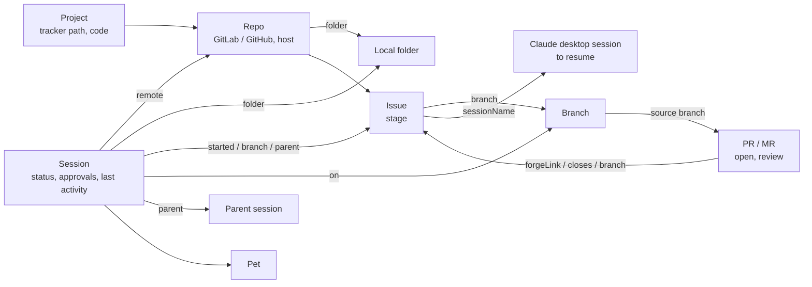

# The work model

One place in the Rust core, [`src-tauri/src/model.rs`](../src-tauri/src/model.rs), says how your projects, repositories, issues, branches, pull / merge requests, Claude Code sessions and their pets link up, and why each link is there. The board, the pets and the end-of-day report read their links from it.

It is built from what Bobix already holds, each time the pages get a new snapshot (a hook event, a git status read, a tracker read): no extra reads of the network or the disk, nothing stored.



## Entities

| Entity | What it is | Comes from |
|---|---|---|
| Project / Repo | A tracker project ("group/sub/project" on GitLab, "owner/repo" on GitHub, lower case), its code for session names (`key`, Settings → codes, else made from the name), its forge and host, and the folders here that hold a clone. The same path on two hosts counts as one project. | Your assigned issues, and the git remotes of the sessions' folders |
| Issue | An open issue assigned to you, with its `stage` and the sessions and reviews linked to it. | `glab` / `gh`, read-only |
| Branch | A branch Bobix saw in a project: one a session is on now or was on earlier (its transcript), or a PR / MR's source branch. | Git status, transcripts, the PR / MR list |
| PR / MR (`reviews`) | One of your open pull requests (GitHub) or merge requests (GitLab): url, source branch, state (`open`; only open ones are read), review (GitHub's decision: `approved`, `changes_requested`, `review_required`; none on GitLab yet), when it was opened (`created`), whether anyone reviewed it (`reviewed`: a review on GitHub, a comment on GitLab) and the issues it closes. | `gh api graphql` / `glab api`, read-only |
| Session | A Claude Code session: status (`working`, `waiting`, `done`, `idle`), since when, last activity, the permission requests it waits on (since when; `held` when Bobix can answer it) and its pet (`auto`, `hidden`, `shown`). | Hook events |

## Links and why each is there

Every link carries `why`:

| `why` | Link | Rule |
|---|---|---|
| `remote` | Session → Repo | A git remote of the session's repository points at the project on a host your `glab` / `gh` is signed in to (the first such host, in tracker order). |
| `folder` | Session → folder, Repo → folder | The repository folder the session works in (kept while Claude visits a scratch folder outside git). |
| `started` | Session → Issue | Start on an issue in the panel opened this session (Bobix named it `[KEY-iid] title`). Wins over every other rule. |
| `branch` | Session → Issue, Branch → Issue, PR / MR → Issue | A branch named `<iid>-…` or `<prefix>/<iid>-…`, unless the part after the number is only digits too (a date or a version: `release/2026-11`, `hotfix/2026-11-09`). A session takes the newest of its branches that names one; a PR / MR its source branch, in its own project. |
| `parent` | Session → Session, Session → Issue | `spawnedFrom` in Claude desktop's session file: a side session. A side session whose own branches name no issue works on its parent's issue, when both are in the same project. |
| `sessionName` | Issue → Claude desktop session | A Claude desktop session in the project's folder named `[KEY-iid]…` or `<project name> #<iid>…` (the newest one): the one to resume. |
| `forgeLink` | PR → Issue | The issues GitHub itself links to the pull request (closing references). |
| `closes` | PR / MR → Issue | `Closes #n`, `Fixes #n`, `Resolves #n`, `Implements #n` in its description. |

A PR / MR names each issue once, for its first reason in that order: `forgeLink`, `closes`, `branch`.

## Stage of an issue

`ask` while a live session on it waits for your approval, else `doing` while one works on it (an open PR / MR or not), else `verify` when an open PR / MR closes it, else `doing` while a live session is on it, else `todo` (`stage_of`). The board lists `ask` with the tickets in progress, and shows the five steps To do → In progress → Needs approval → Waiting for review → Done on an opened ticket, with why it is where it is. "Done" on the board and in the report are the issues assigned to you that were closed since local midnight; the panel decides the day by its own clock.

## What the pages get

The snapshot on `/events` carries, as before, `work` (issues grouped by project, now each with `stage`), `waiting` and `sessions` (each with `parent` and `issue`, read from the model), plus the whole model, read-only, as `model`:

```text
{ "repos": [{ "path", "key", "autoKey", "forge", "host", "dirs": [{ "path", "why" }] }],
  "issues": [{ "project", "iid", "title", "url", "stage", "sessions": [{ "id", "why" }], "reviews": [{ "url", "why" }], "resume": { "id", "why" } }],
  "reviews": [{ "kind", "url", "project", "branch", "state", "review", "created", "reviewed", "issues": [{ "project", "iid", "why" }] }],
  "branches": [{ "project", "name", "issue": { "project", "iid", "why" }, "sessions", "reviews" }],
  "sessions": [{ "id", "status", "since", "lastActivity", "approvals": [{ "tool", "ask", "since", "held" }], "pet", "dir", "repo", "issue", "parent" }] }
```

With every tracker off, the model has no projects, issues or reviews; sessions still have their parent.

The tests in `src-tauri/src/main.rs` (`snapshot_tests`) build one fixture with every rule above and check both the links with their reasons and that the pages get the same JSON as before the model (`test/fixtures/work-snapshot.json`).

## Stuck work

The board's "Stuck work" (`stuck` in `src/ui/board.js`) reads the model and the sessions, with the limits in Settings → Stuck work (hours):

| Kind | When | Next step |
|---|---|---|
| `nopr` | An issue with no open PR / MR whose sessions all stopped, one of them having finished its turn, longer than "Finished session with no PR / MR after" (2 h) | The forge's new PR / MR page for that session's branch, else the session |
| `noreview` | An open PR / MR nobody reviewed, opened longer ago than "PR / MR nobody reviewed after" (24 h) | Its link copied, to send to a reviewer |
| `branch` | A session's branch with commits of its own (`git.own`: not on the remote's default branch, `origin/HEAD`), no open PR / MR from it and no session working on it, last commit older than "Branch with commits and no PR / MR after" (4 h) | The forge's new PR / MR page |
| `idle` | An issue whose sessions all rest without having finished a turn, no activity for "An issue's sessions resting for" (4 h) | The session |

"Skip" hides an item until Bobix restarts.
